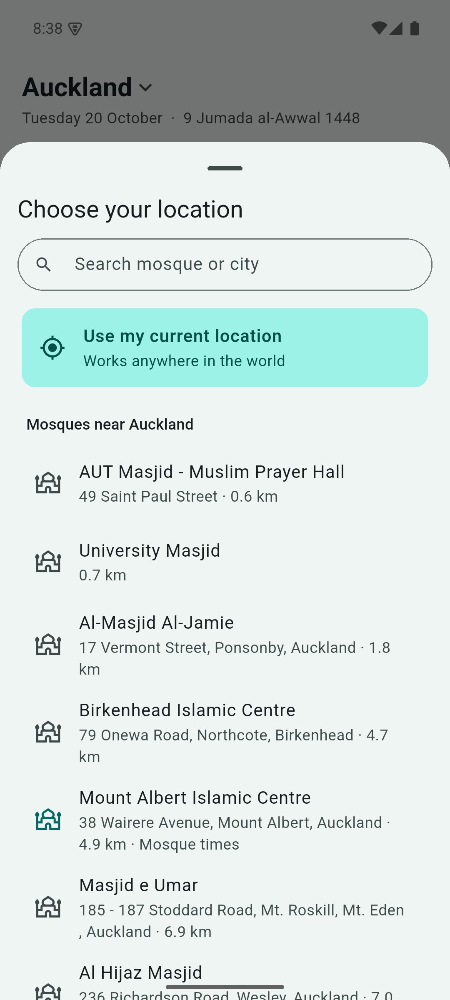
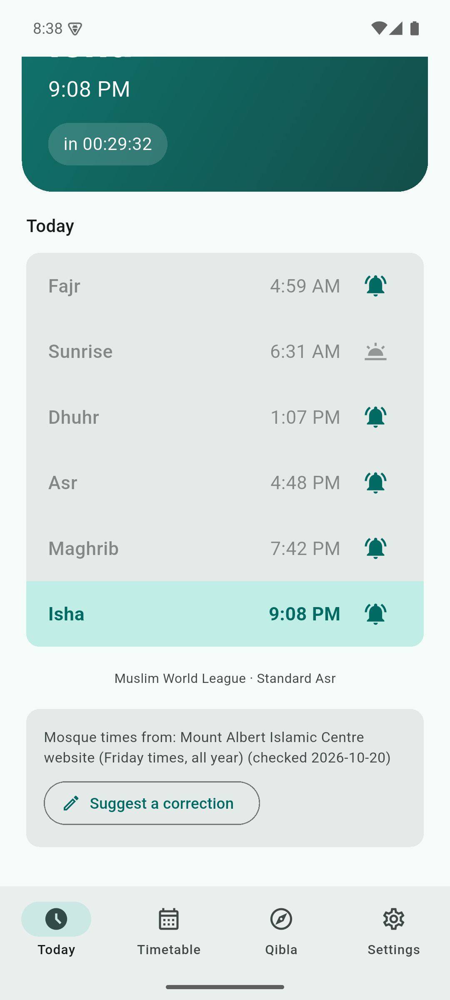
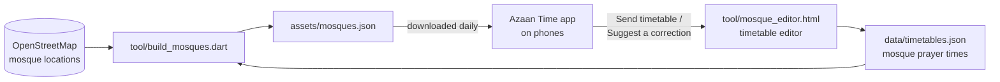
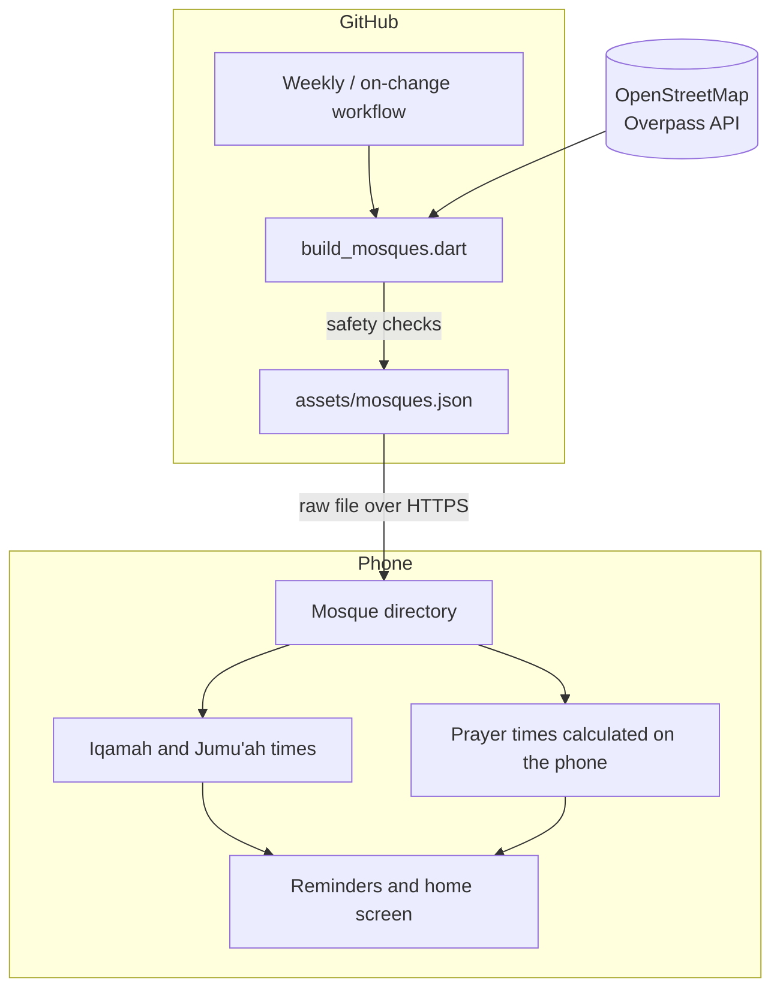

# Azaan Time: Mosque List

## What it does

This is the list of mosques used by the **Azaan Time** prayer app. It holds every mosque and Muslim prayer room in New Zealand, and the prayer times that mosques share with us. When this list changes, every phone with Azaan Time picks up the change by itself, with no app update.

## A real-life example

**Aisha** prays at Mount Albert Islamic Centre in Auckland. Before, her phone's prayer app showed general Auckland times, so she checked the mosque's website every week to know when Friday prayer started.

Now she picks *Mount Albert Islamic Centre* in Azaan Time once. Her app shows the mosque's own Friday times (khutbah 1:40 PM, prayer 2:00 PM) and reminds her an hour before. When the mosque changes a time, it is updated here once, and Aisha's phone follows within a day. That saves her a weekly website check and a missed khutbah.

## How you would use it

**If you pray at a mosque:**
1. Open Azaan Time and tap the place name at the top.
2. Pick your mosque from the list (nearest first), or search for it.
3. That's it. Your prayer times now follow your mosque.

**If your mosque's times are missing or wrong:**
1. In Azaan Time, tap **Send this mosque's timetable** or **Suggest a correction**.
2. Attach a photo of the mosque's timetable, or type the times, and send.
3. The times are checked and added here, and every phone gets them.

### What it looks like in the app


*Choosing a mosque: mosques near you are listed first. The highlighted one already has its own prayer times.*


*After choosing a mosque, the app shows where the mosque's times came from and when they were last checked, with a button to suggest a correction.*

---

## How it works

1. **Mosques come from OpenStreetMap**, the free, community-made world map. A small program asks the map for every place tagged as a mosque or Muslim prayer room in New Zealand.
2. **Mosque prayer times are kept in one file**, `data/timetables.json`. Each mosque's congregation times (*iqamah*) are stored as simple rules, such as "Dhuhr at 1:30 PM from April to September" or "Asr 15 minutes after the call to prayer", plus Friday (*Jumu'ah*) times.
3. **The program joins the two** into `assets/mosques.json`, the file the app reads.
4. **GitHub runs this automatically** every week, and whenever the timetables file changes. It only publishes when something really changed.
5. **Phones download the file** at most once a day and keep a copy, so the app still works offline. Nothing about the user is sent; the phone only fetches this public file.



### Architecture



**Safety checks before publishing:** if the map suddenly returns fewer than 80% of the previous mosques (for example a server fault), the update is refused, so mosques never disappear from phones by accident. Unchanged data is not republished.

## Timetable format

Each entry in `data/timetables.json` is keyed by the mosque's OpenStreetMap ID:

```json
{
  "node/3700505525": {
    "source": "Mount Albert Islamic Centre website (Friday times, all year)",
    "updated": "2026-10-20",
    "iqamah": {
      "dhuhr": [
        { "from": "04-01", "to": "09-30", "at": "13:30" },
        { "from": "10-01", "to": "03-31", "at": "13:45" }
      ],
      "asr": [{ "after": 15 }]
    },
    "jumuah": [{ "khutbah": "13:40", "prayer": "14:00" }]
  }
}
```

| Field | Meaning |
|---|---|
| `source`, `updated` | Where the times came from and when they were checked. Shown in the app. |
| `iqamah.<prayer>` | A list of seasons. Each has `from`/`to` dates and either `at` (fixed time, 24-hour) or `after` (minutes after the call to prayer). Dates are `MM-DD` to repeat every year (a season may run past New Year) or `YYYY-MM-DD` for a timetable published for one year only. |
| `daylightSaving` | Optional on any season or Friday session: `true` = only during daylight saving, `false` = only in standard time. Follows New Zealand's real clock change each year. |
| `jumuah` | Friday sessions: `khutbah` (optional) and `prayer` times, with optional dates and `daylightSaving` like iqamah seasons. |
| `method`, `hanafiAsr`, `azaanOffsets` | Optional. The mosque's own calculation settings, so the app's call-to-prayer times match the mosque. |

## Tech stack

- **Data source:** OpenStreetMap via the Overpass API
- **Build program:** Dart (`tool/build_mosques.dart`, no extra packages)
- **Editor:** a single HTML page with plain JavaScript, no install needed
- **Automation:** GitHub Actions
- **Hosting:** this GitHub repository; phones read `assets/mosques.json` directly

## Setup and usage

You need the [Dart SDK](https://dart.dev/get-dart) (or Flutter, which includes it).

**Add or change a mosque's times:**
1. Open `tool/mosque_editor.html` in a web browser.
2. Load `assets/mosques.json` and `data/timetables.json` with the two file pickers.
3. Search for the mosque, enter its times, and click **Save this mosque**.
4. Click **Download timetables.json** and replace `data/timetables.json` with it.
5. Commit and push. GitHub rebuilds and publishes the list within a few minutes.

You can also edit `data/timetables.json` directly on github.com; the same automatic rebuild runs.

**Rebuild by hand:**
```bash
dart run tool/build_mosques.dart
```
If the map servers are busy, download the map data yourself and pass the file:
```bash
dart run tool/build_mosques.dart osm.json
```

**Run the update on GitHub now:** Actions → *Update mosque list* → *Run workflow*.

No API keys or secrets are needed.

## Project structure

```
assets/mosques.json          the published list the app downloads
data/timetables.json         mosque prayer times, one entry per mosque
data/corrections.json        fixes for wrong map details, e.g. a website that belongs to another mosque
tool/build_mosques.dart      builds assets/mosques.json from OpenStreetMap + timetables
tool/mosque_editor.html      browser editor for timetables
.github/workflows/           weekly and on-change automatic rebuild
docs/screenshots/            screenshots used in this README
```

## Tests and current numbers

The Azaan Time app's test suite checks this data and the rules that use it:
- every mosque has a name, unique ID and a location inside New Zealand
- seasons that run past New Year, fixed and "minutes after" iqamah times
- a fixed iqamah time never comes before the call to prayer
- Friday sessions are read correctly

**Current data:** 67 mosques and prayer rooms across New Zealand; 3 mosques with times they published themselves (Mount Albert Islamic Centre, Al-Mustafa Jamia Masjid, Palmerston North Islamic Centre). The list is refreshed from OpenStreetMap every week.

Only times a mosque has published as a standing rule (or for a stated period) are added. Times that are out of date, or only valid for a single day, are left out so nobody is sent to the mosque at the wrong time.

## Licence

- **Mosque data** is © OpenStreetMap contributors and available under the [Open Database License](https://opendatacommons.org/licenses/odbl/1-0/). If you reuse it, credit OpenStreetMap and share changes under the same licence.
- **Tools and documentation** are under the MIT License.

See [LICENSE](LICENSE).
